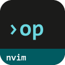
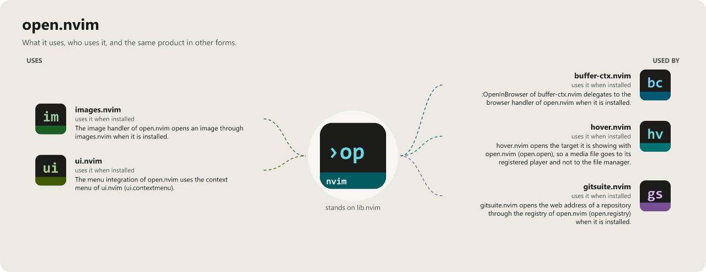

> **Beta stage — active development.** This repository is past its first shape and in
> active use, but the surface is not frozen: breaking changes are still possible. Pin a
> commit or tag if you depend on it.

# open.nvim

```
 ██████╗ ██████╗ ███████╗███╗   ██╗
██╔═══██╗██╔══██╗██╔════╝████╗  ██║
██║   ██║██████╔╝█████╗  ██╔██╗ ██║
██║   ██║██╔═══╝ ██╔══╝  ██║╚██╗██║
╚██████╔╝██║     ███████╗██║ ╚████║
 ╚═════╝ ╚═╝     ╚══════╝╚═╝  ╚═══╝
                              .nvim
```

[](LICENSE)
[](https://neovim.io)
[](https://www.lua.org)


[](https://github.com/WKDSteve/open.nvim/actions/workflows/ci.yml)
[](https://wkdsteve.github.io/wkd/p/open/)

> Part of the [wkd](https://wkdsteve.github.io/wkd/) family — see this plugin's [page](https://wkdsteve.github.io/wkd/p/open/) on the site.

Open files, URLs and paths from anywhere in Neovim, with one command.
`:Open [target] [scope]` routes the thing under your cursor — a path, a URL, or
plain text — to the right destination, and it goes the other way too:
`:Open viewer` lists every link in a buffer, a selection or the whole project
and hands you a picker.

---

## Around it

> **[insights.nvim](https://github.com/WKDSteve/insights.nvim)** — for
> understanding a project's structure *before* opening files in it: who imports
> what, which imports are unused, where the symbols are.
>
> **[markdown.nvim](https://github.com/WKDSteve/markdown.nvim)** — the
> Markdown side of the same cursor question, with its own dispatcher over
> anchors, images and headings inside a document.
>
> **[images.nvim](https://github.com/WKDSteve/images.nvim)** — draws an
> image in the editor rather than handing it to the system viewer; open.nvim
> uses it when it is there and falls back when it is not.
>
> All of the above are soft: without them everything else works unchanged.
> [lib.nvim](https://github.com/WKDSteve/lib.nvim) is the one real
> dependency — see [Requirements](docs/installation.md#requirements).

---

## Documentation

Start at [docs/README.md](docs/README.md), which says what is where and which
question each page answers.

### The Basics

- [Requirements](docs/installation.md#requirements) — Neovim version, required plugins and CLI tools.
- [Installation](docs/installation.md) — a spec per plugin manager.
- [Quickstart](docs/quickstart.md) — the first thing to run after installing.

### Configuration

- [What you get with the defaults](docs/cheatsheet.md) — every handler, the scope tokens, the platform dispatch, and common examples, all on one screen.
- [All options](docs/configuration.md) — every `setup()` option, with the full defaults printed out.
- [Command reference](docs/commands.md) — the two command families in full, and what each argument does.
- [Bindings](docs/BINDINGS.md) — every user command, keymap and autocommand this plugin registers.

### The Rest

- [Features](docs/FEATURES/README.md) — one page per area: [the core](docs/FEATURES/CORE.md), [the handlers](docs/FEATURES/HANDLERS.md), [the viewer](docs/FEATURES/VIEWER.md).
- [Workflow](docs/WORKFLOW.md) — how the commands combine day to day, `:Open viewer` against a direct handler, and the traps.
- [Built-in keywords](docs/keywords.md) — named scope shortcuts for shell, editor, git, SSH and other config files, and how to add your own.
- [Lua API](docs/api.md) — every function a config or another plugin can call.
- [Integrations](docs/integrations.md) — which other plugins this reaches, which it supersedes, and what changes when one is absent.
- [Health check](docs/health-check.md) — what `:checkhealth open` reports, and how to read it.
- [Contributing](docs/CONTRIBUTING.md) — ground rules, project layout, and how to add a handler.
- [Feedback](https://github.com/WKDSteve/open.nvim/issues) — bugs, feature requests and usage questions; broader discussion in [Discussions](https://github.com/WKDSteve/open.nvim/discussions).

`:help open` is the same reference inside the editor.

---

## License

[](LICENSE)

open.nvim is released under the [MIT License](https://opensource.org/licenses/MIT).

<!-- connections:begin (written by the app-icons tool of the workshop; change integrations.json there, not this block) -->
## Connections



**Uses**

- [images.nvim](https://github.com/WKDSteve/images.nvim): The image handler of open.nvim opens an image through images.nvim when it is installed. ([picture](assets/graphs/pair/open.nvim--images.nvim.png))
- [ui.nvim](https://github.com/WKDSteve/ui.nvim): The menu integration of open.nvim uses the context menu of ui.nvim (`ui.contextmenu`). ([picture](assets/graphs/pair/open.nvim--ui.nvim.png))
- [lib.nvim](https://github.com/WKDSteve/lib.nvim): the shared base of the plugins.

**Used by**

- [buffer-ctx.nvim](https://github.com/WKDSteve/buffer-ctx.nvim): `:OpenInBrowser` of buffer-ctx.nvim delegates to the browser handler of open.nvim when it is installed. ([picture](assets/graphs/pair/buffer-ctx.nvim--open.nvim.png))
- [gitsuite.nvim](https://github.com/WKDSteve/gitsuite.nvim): gitsuite.nvim opens the web address of a repository through the registry of open.nvim (`open.registry`) when it is installed. ([picture](assets/graphs/pair/gitsuite.nvim--open.nvim.png))
- [hover.nvim](https://github.com/WKDSteve/hover.nvim): hover.nvim opens the target it is showing with open.nvim (`open.open`), so a media file goes to its registered player and not to the file manager. ([picture](assets/graphs/pair/hover.nvim--open.nvim.png))
<!-- connections:end -->
